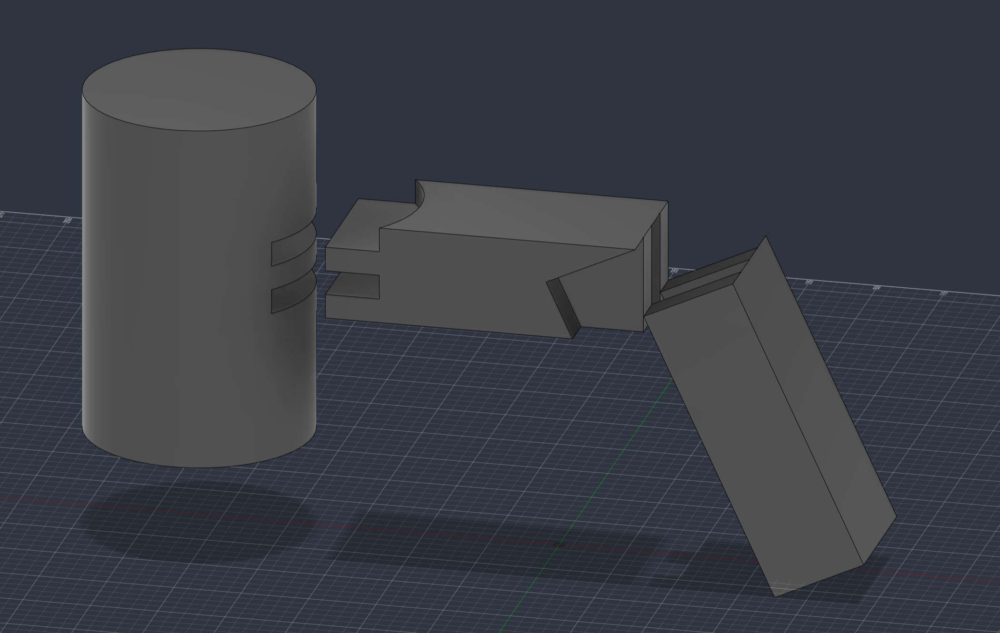
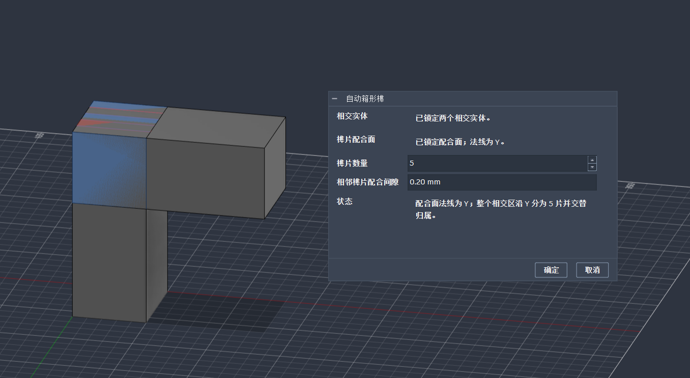
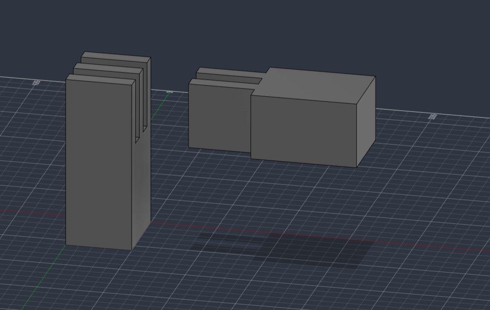

# 自动箱形榫（Fusion Auto Box Joint）

用于 Autodesk Fusion 的中文加载项：分析两个实体的真实体积相交区，将相交区分成若干榫片并交替切割两个源实体，从而快速得到适合 3D 打印装配的箱形榫/指接结构。

> 当前为社区测试版。建议先在测试模型或副本上验证榫片方向、数量和间隙，再用于正式模型。

## 主要功能

- 自动识别两个实体的真实体积相交区，而不是只使用外包围盒。
- 自动生成半透明相交预览体，只允许从该预览体选择配合面。
- 按配合面法线方向将整个相交区等分，并让榫片在两个实体之间交替归属。
- 可设置榫片数量和相邻榫片配合间隙。
- 同时兼容参数化设计与直接建模文档。
- 中文命令窗口、状态提示和完整尺寸工具栏图标。
- 命令默认不固定到工具栏，由用户自行决定是否固定。

## 用例与界面截图

### 多种实体和连接角度

相交区会按真实几何边界裁切，因此可用于普通正交实体，也可用于圆柱面附近或倾斜实体形成的相交区域。复杂模型应先在副本中验证切割结果。



### 参数设置与榫片预览

选择两个相交实体和一个配合面后，命令窗口会锁定选择，并显示榫片数量、配合间隙和当前分片方向。画布中的红蓝交替区域表示两个实体各自保留的榫片。



### 分体后的切割结果

确认后，插件对两个源实体执行互补切割。将实体移开即可检查榫头、榫槽是否交替且边界完整。



## 下载与安装

### 推荐：从 GitHub Release 安装

1. 打开 [Releases 页面](https://github.com/kongbai0721-netizen/Fusion-Auto-Box-Joint/releases)。
2. 下载最新版 `AutoBoxJoint-v*-windows.zip`。
3. **完全退出 Autodesk Fusion**，包括仍在后台运行的 Fusion 进程。
4. 解压 ZIP，得到顶层文件夹 `AutoBoxJoint`。
5. 按 `Win + R`，输入以下路径并回车：

   ```text
   %APPDATA%\Autodesk\Autodesk Fusion 360\API\AddIns
   ```

6. 将整个 `AutoBoxJoint` 文件夹复制到 `AddIns` 目录。最终结构应类似：

   ```text
   AddIns\
   └─ AutoBoxJoint\
      ├─ AutoBoxJoint.manifest
      ├─ AutoBoxJoint.py
      ├─ fusion_auto_box_joint.py
      ├─ Resources\
      └─ docs\
   ```

7. 启动 Fusion。清单已设置 `runOnStartup: true`，插件应自动加载。

### 检查是否成功启用

如果菜单中没有出现命令：

1. 打开“实用程序 → 脚本和加载项”。
2. 切换到“加载项”选项卡。
3. 找到 `AutoBoxJoint`，点击“运行”。
4. 勾选“启动时运行”。
5. 回到“设计”工作空间的“实体”选项卡检查“修改”菜单。

## 工具栏入口

命令位置：

```text
设计工作空间 → 实体 → 修改 → 自动箱形榫
```

按钮默认只出现在“修改”菜单中，不会强制占用工具栏空间。需要常驻时，在 Fusion 中打开“修改”菜单，对“自动箱形榫”使用“固定到工具栏”；取消固定也由用户自行操作。

## 建模前提

运行命令前请确认：

1. 两个对象都是 **实体（Solid Body）**，不是曲面、网格或草图。
2. 两个实体必须有真实的体积相交；只有面接触、边接触或存在间隙时无法生成相交体。
3. 两个实体应位于当前正在编辑的组件中。若它们属于不同组件，请先激活共同的父组件或整理到同一编辑上下文。
4. 相交区必须是一个连续实体；存在多个彼此分离的相交岛时，应拆分后分别处理。
5. 先保存设计或建立副本，尤其是测试复杂斜面、圆柱或薄壁模型时。

## 完整操作步骤

1. **准备相交实体**：移动两个实体，使计划制作榫卯的位置产生足够深度的体积重叠。
2. **启动命令**：打开“实体 → 修改 → 自动箱形榫”。
3. **选择两个实体**：依次点击两个不同的实体。选择第二个实体后，插件会自动计算并显示半透明相交预览体。
4. **选择配合面**：只能在半透明相交预览体上选择一个平面。该面的法线决定榫片的等分方向。
5. **设置榫片数量**：输入希望在整个相交区内生成的榫片总数。数量越多，单片越薄。
6. **设置配合间隙**：输入相邻榫片之间的间隙。FDM 打印可从 `0.20 mm` 开始试验，再根据材料、喷嘴和机器精度调整。
7. **检查预览和状态**：确认交替区域没有超出真实相交边界，状态文本中的轴向和分片数量符合预期。
8. **点击“确定”**：插件将创建切割特征并修改两个源实体。
9. **移开实体复核**：使用“移动/复制”，将“移动对象”设置为“实体”，把两个实体分开检查互补榫片。
10. **打印前试配**：建议先截取局部或打印小型试件，确认间隙后再打印完整零件。

## 参数说明

| 参数 | 作用 | 建议 |
| --- | --- | --- |
| 相交实体 | 定义需要进行互补切割的两个源实体 | 必须是两个不同且有体积相交的实体 |
| 榫片配合面 | 定义分片方向；只能选择相交预览体的平面 | 选择与期望榫片排列方向相匹配的面 |
| 榫片数量 | 将整个相交区等分为指定数量的条带 | 单片宽度不得小于插件的最小安全值；过多时请减少数量 |
| 相邻榫片配合间隙 | 在相邻榫片之间预留装配余量 | FDM/PETG 可先试 `0.20 mm`，紧则增大、松则减小 |

间隙是几何设计参数，不等同于切片软件中的水平扩展、孔补偿或流量补偿。最终合适数值取决于材料收缩、打印方向、层高、喷嘴直径和设备校准状态。

## 结果检查

确认后建议检查以下内容：

- 两个实体仍然是彼此独立的实体。
- 榫片在两个实体之间交替归属，没有同一位置同时保留或同时挖空。
- 切割没有越过真实相交区，斜面或曲面附近没有出现矩形过切。
- 每个榫片仍有足够壁厚，尖角和薄片不会在打印或装配时断裂。
- 移开实体后可以沿预期装配方向重新插合。

## 常见问题

### 选择第二个实体后没有预览

- 确认两实体存在体积重叠，而不是刚好贴面。
- 确认选择的是实体，不是面、零部件或网格体。
- 相交区包含多个独立区域时，先拆分模型后分别生成。

### 无法选择“榫片配合面”

配合面选择阶段只允许捕捉半透明相交预览体的平面，源实体的面会被临时禁止选择。请点击预览体上清晰可见的平面，不要选择曲面。

### “确定”按钮不可用

- 尚未正确选择两个实体或一个有效配合面。
- 榫片数量太多，导致单片宽度不足。
- 配合间隙为负数或模型相交尺寸过小。
- 查看命令窗口底部“状态”文本，它会给出当前限制原因。

### 取消后实体呈半透明或不能选择

最新版会在命令完全结束后恢复源实体。如果 Fusion 曾异常退出，可先关闭当前命令，再到“脚本和加载项”中停止并重新运行 `AutoBoxJoint`；必要时重启 Fusion。

### “移动/复制”无法选中结果实体

打开“移动/复制”后，将“移动对象”从“零部件”切换为“实体”，然后再选择需要移开的实体。

### 如何提交问题

请在 [GitHub Issues](https://github.com/kongbai0721-netizen/Fusion-Auto-Box-Joint/issues) 中附上：

- Fusion 版本和 Windows 版本；
- 参数化设计或直接建模；
- 两实体相交前后的截图；
- 配合面方向、榫片数量和间隙；
- 是否可以在简单方块模型上复现。

请勿上传包含个人信息、商业机密或无法公开的设计文件。

## 升级与卸载

### 升级

从早期版本升级时，请先在 Fusion 中停用旧的定制版。旧目录 BoxJoint 也可能属于 Mark Suska 的原版，请核对作者和内容，保留原版及用户文件。新版单独安装在 AutoBoxJoint 目录。

1. 完全退出 Fusion。
2. 备份或删除旧的 `AddIns\AutoBoxJoint` 文件夹。
3. 将新版压缩包中的完整 `AutoBoxJoint` 文件夹复制进去。
4. 不要把新文件逐个混入旧目录，以免残留旧脚本或缓存。

### 卸载

完全退出 Fusion，然后删除：

```text
%APPDATA%\Autodesk\Autodesk Fusion 360\API\AddIns\AutoBoxJoint
```

## 开发与重新打包

仓库内的 `build_package.ps1` 会按清单版本生成干净的 Windows ZIP，并排除日志、缓存和本机环境文件：

```powershell
.\build_package.ps1
```

## 兼容性

- Autodesk Fusion（Windows）
- 参数化设计与直接建模文档
- 面向 FDM 等 3D 打印装配场景

## 许可与来源

本项目基于 Mark Suska 的 BoxJoint 项目代码和图标资源进行定制，继续保留原 MIT License 和版权声明。定制版本同样依据 MIT License 开放使用、修改和再分发。
